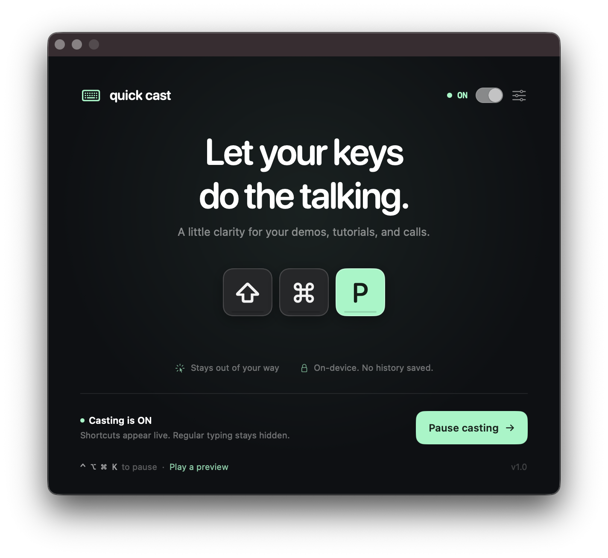

# Quick Cast

Let your keys do the talking. A native macOS keystroke overlay for demos, tutorials, recordings, and calls.

Individual glass keycaps float above your apps with no surrounding panel. The overlay never takes focus or intercepts clicks, then fades away after you stop typing.

## Features

- Shortcuts only by default; optionally show all keys, including typing
- Layout-aware characters, standalone modifiers (including Caps Lock remapped to Hyper), navigation keys, and F1–F20
- Recent shortcuts and a repeat counter for consecutive presses
- Six positions, three sizes, three accent colors, and adjustable fade timing
- Appears on the display containing your pointer; works across Spaces and alongside full-screen apps
- **⌃⌥⌘K** to pause or resume; explicit **ON / OFF** indicators in the window and menu bar
- Casting switch and Pause / Resume button in the window; your choice survives relaunches
- Separate access, connection, pause, and protected-input states with automatic access detection
- Built-in preview that works without keyboard permissions
- Reduced Motion support
- No dependencies, accounts, network requests, or keystroke files

Requires macOS 14 Sonoma or later. Builds for the architecture of your Mac.

## Build and run

Install the Swift toolchain through Xcode or Command Line Tools, then:

```sh
make test
make run
```

`make run` builds an app bundle at `dist/Quick Cast.app` and opens it. Run the bundle rather than the bare executable so macOS associates permissions with Quick Cast.

To install locally:

```sh
make install
```

This copies the bundle into `/Applications` and launches it. To use a different destination, pass `INSTALL_DIR="$HOME/Applications"`.

## First launch

1. Click **Enable access** in the welcome window.
2. Enable **Quick Cast** in **System Settings → Privacy & Security → Input Monitoring**. If it isn't listed, add the app using the **+** button.
3. If macOS asks you to quit and reopen the app, do so. The app detects access automatically when a restart is not required.
4. Press a shortcut in another app. Use the Quick Cast ON/OFF item in the menu bar to customize the overlay.

If Input Monitoring is enabled but the window still says access is needed after replacing an old ad-hoc build, remove Quick Cast from the Input Monitoring list with **−**, add the current app again with **+**, then choose **Quit & Reopen**. Switching the existing toggle off and on can preserve the old code-signing requirement instead of refreshing it.

**Play a preview** shows a short sample sequence without Input Monitoring access. Preview does not change your capture mode or pause state.

For a presentation or recording, capture the entire display to include the overlay. Capturing an individual application window may omit it because the HUD is a separate window. Test your recording setup first.

## Controls

| Control | Options |
| --- | --- |
| Pause / resume | Menu bar or ⌃⌥⌘K when monitoring is available |
| Show | Shortcuts only / all keys including typing |
| Position | Top or bottom; left, center, or right |
| Size | 80%, 100%, 125% |
| Fade after | 1, 2, or 3 seconds |
| Accent | Mint, lilac, peach |
| Recent shortcuts | Show / hide |
| Settings & help | Reopen the welcome window |

Key-down events and modifier presses are displayed. Hyper (Control + Option + Shift + Command) is rendered as one **Hyper** keycap. Quick Cast automatically recognizes Kiwi’s Caps Lock → F18 mapping when Kiwi is running, and observes it before Kiwi consumes the source key. Quit and reopen Quick Cast after starting or restarting Kiwi so its listener precedes Kiwi again. Modifier releases do not add partial chords to history. Mouse clicks, the standalone Fn/Globe key, and media keys are not shown. Shortcut mode shows standalone modifiers and chords containing Command, Option, or Control; Shift + a letter is treated as typing.

## Privacy

Keyboard events are used only to draw the live overlay. Up to four entries are held temporarily in memory and cleared after fading, pausing, or switching capture modes. Only preferences are persisted. No keystrokes are logged or transmitted.

The overlay is suppressed while macOS Secure Input is active. This relies on applications enabling Secure Input for protected entry; it is not a general sensitive-text detector. Use **Pause casting** whenever you don't want keys shown. In all-keys mode, ordinary text is visible to anyone watching your screen.

## Development

```sh
swift build                   # Debug build
swift test                    # Core behavior tests
./scripts/package.sh --debug  # Debug app bundle
make package                  # Release app bundle
open "dist/Quick Cast.app" --args --demo
```

The package script creates the icon and uses the first available Apple Development signing identity, keeping the app identity stable across rebuilds. Set `SIGN_IDENTITY` to select a specific identity (or `-` for ad-hoc signing). Without an Apple Development identity, the script falls back to ad-hoc signing and prints a notice. Switching from an old ad-hoc build can require refreshing Input Monitoring once; ad-hoc rebuilds may need this every time. The bundle is not notarized or configured for App Store distribution.

The core module contains key decoding, filtering, and bounded shortcut history. AppKit handles passive keyboard monitoring, the menu bar, permissions, and the non-activating panel; SwiftUI draws the HUD and welcome screen.

## License

MIT
